<div align="center">



<a href="https://github.com/1Ayazahmed">
  
</a>

</div>

```bash
ayaz@karachi:~$ cat about.md
```

```yaml
name:        Ayaz Ahmed
titles:      [Vibe Coding Expert, Forward Deployed Engineer, Full Stack Developer]
now:         Full Stack Developer @ IT Agency
location:    Karachi, Pakistan
experience:  5+ years
focus:       SaaS products, full-stack web apps, AI agents, automation
seo:         intermediate (SEO + website optimization)
learning:    AI tech stack, Rust
ask_me:      React, Node.js, Laravel, MongoDB, Python, WordPress, n8n
workflow:    plan -> code -> security inspect -> ship
```

```bash
ayaz@karachi:~$ ls contact/
```

<p>
  <a href="https://github.com/1Ayazahmed"></a>
  <a href="https://linkedin.com/in/ayaz-ahmed-018006355"></a>
  <a href="mailto:ayazkk616@gmail.com"></a>
  <a href="https://wa.me/923033383180"></a>
</p>

---

```bash
ayaz@karachi:~$ ./pipeline --watch
```



```bash
ayaz@karachi:~$ cat vibe_coding.yaml
```

```yaml
vibe_coding:
  agents_ides: [Cursor, Trae, Kiro, CodeBuddy, Codex, Claude, Grok, Muse AI]
  extend_with: [expert skills, MCP tools, token compressors]
  loop:
    1_plan:    spec + architecture before any code
    2_code:    agent-assisted, expert skills loaded per task
    3_inspect: security skills audit the app
    4_ship:    deploy, monitor, iterate
  builds:      [SaaS products, full-stack web apps]
  stacks:      [Laravel, Node.js, MERN, Python]
  learning:    [AI tech stack, Rust]
fde:
  mode: forward deployed, embed with the problem, ship working product
```

<p>
  
  
  
  
  
  
  
  
  
  
  
  
</p>

---

```bash
ayaz@karachi:~$ cat stack.txt
```

**frontend**<br>


**backend**<br>


**data**<br>


**cms / ecommerce**<br>


**devops / cloud**<br>


**tools**<br>


```text
ai / automation : n8n, OpenAI, Anthropic, Groq, LangChain, RabbitMQ, Kafka
seo / optimize  : technical SEO, performance, accessibility (intermediate)
also            : Hostinger, cPanel
```

---

```bash
ayaz@karachi:~$ git log --career
```

```text
* NOW            Full Stack Developer — IT Agency (Karachi)
|                - full-stack apps for multiple clients: MERN, Laravel
|                - AI features + automation workflows
|                - building open-source WordPress plugins and AI chatbots
|
* 2025-08..12    Full Stack AI Intern — EnlightSystems.com (Remote)
|                - React + Flask + Python features in agile team
|                - REST APIs, secure auth flows
|                - n8n workflows: Google Sheets, Telegram bots, backend services
|                - domains + hosting on Hostinger
|
* 2023 (3 mo)    WordPress & Front-End Developer — Zibble Tech
|                - custom WP themes and pages
|                - UI bug fixes, performance work, hosting + domains
|
* 2022-2023      Frontend & CMS Developer — Digital Candy (Freelance)
                 - CMS sites + Shopify stores (Liquid, HTML, CSS, JS)
                 - theme customization, plugin/API integrations
                 - responsive + cross-browser, hosting/DNS
```

```text
EDU  B.S. Software Engineering — Muhammad Ali Jinnah University (2021-2025)
```

---

```bash
ayaz@karachi:~$ ls -la projects/
```

<table>
  <tr>
    <td width="33%" valign="top">
      <h3 align="center">AZ Optimizer</h3>
      <p align="center"><sub>WordPress Intelligence Dashboard</sub></p>
      <p>WordPress plugin that scans and fixes <strong>35+ issues</strong> across security, SEO, performance, and accessibility. Health score engine, one-click auto-fix, AI recommendations, scheduled scans.</p>
      <p align="center">
        
        
        
      </p>
      <p align="center">
        <a href="https://github.com/1Ayazahmed/Wordpress-Website-Intelligence-Dashboard-Security-SEO-Performance-Accessibility"></a>
      </p>
    </td>
    <td width="33%" valign="top">
      <h3 align="center">AI Assistant + Knowledge Graph</h3>
      <p align="center"><sub>WordPress AI Chatbot</sub></p>
      <p>Self-hostable chatbot with <strong>knowledge graph visualization</strong>. Multi-provider (OpenAI, Anthropic, Groq, Ollama), site content sync, white-label, multi-language, analytics. Open source, no vendor lock-in.</p>
      <p align="center">
        
        
        
      </p>
      <p align="center">
        <a href="https://github.com/1Ayazahmed/AI-Chat-Assistant-for-WordPress-with-Multi-Provider-Support-Website-Content-Sync-Knowledge-Graph"></a>
      </p>
    </td>
    <td width="33%" valign="top">
      <h3 align="center">AI-Powered E-Commerce</h3>
      <p align="center"><sub>MERN + Python</sub></p>
      <p>Full e-commerce platform with AI product recommendations, chatbot, AI description generator, sales analytics with predictive charts, cart, admin controls, role-based auth.</p>
      <p align="center">
        
        
        
        
      </p>
      <p align="center">
        <a href="https://github.com/1Ayazahmed/AI-Powered-Ecommerce"></a>
      </p>
    </td>
  </tr>
</table>

<table>
  <tr>
    <td width="50%" valign="top">
      <h3 align="center">Perfect-Web-Cloner</h3>
      <p align="center"><sub>AI-Powered Website Cloning Tool</sub></p>
      <p>Open-source tool that clones a public website's design, layout, and structure from a URL. Scrapes, analyzes, rebuilds with AI/ML. <em>In active development.</em></p>
      <p align="center">
        
        
        
      </p>
      <p align="center">
        <a href="https://github.com/1Ayazahmed/Perfect-Web-Cloner"></a>
      </p>
    </td>
    <td width="50%" valign="top">
      <h3 align="center">Suno Song Downloader</h3>
      <p align="center"><sub>Browser Extension</sub></p>
      <p>Browser extension to download songs from Suno. <em>(more projects loading...)</em></p>
      <p align="center">
        
        
      </p>
      <p align="center">
        <a href="https://github.com/1Ayazahmed/suno-app-song-donwloader-extension"></a>
        <a href="https://github.com/1Ayazahmed?tab=repositories"></a>
      </p>
    </td>
  </tr>
</table>

---

```bash
ayaz@karachi:~$ gh stats --me
```

<details>
  <summary><b>expand</b></summary>
  <br/>
  <p align="center">
    
    
  </p>
</details>

---

```bash
ayaz@karachi:~$ ./hire.sh --collab --freelance --fulltime
> open to collaborations, freelance projects, full-time roles.
> reach me: ayazkk616@gmail.com
```

<div align="center">
  
</div>
